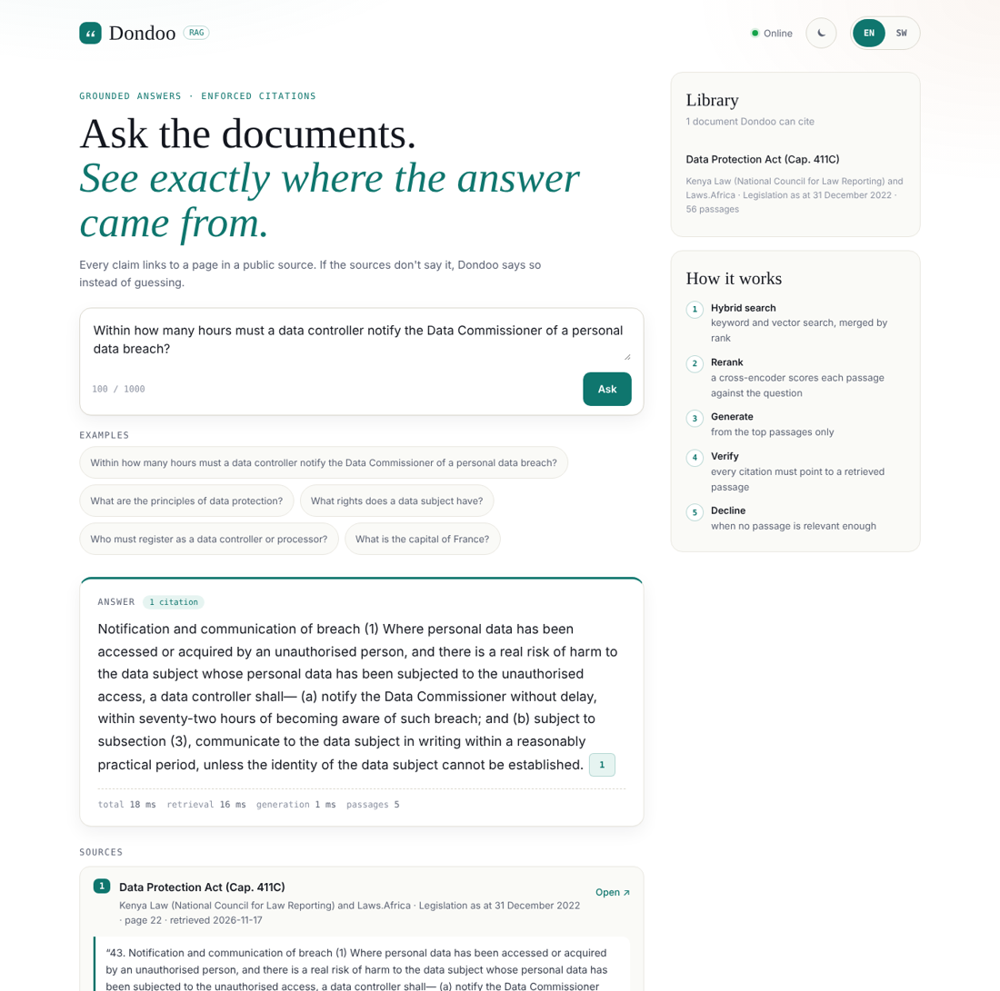
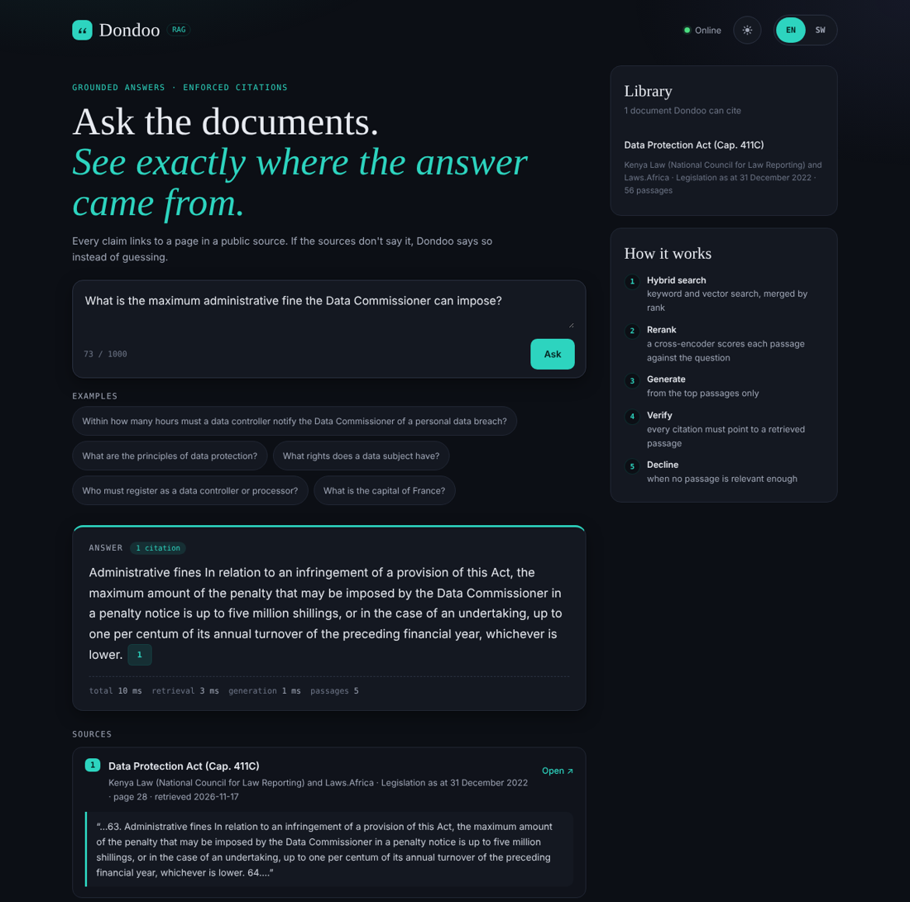
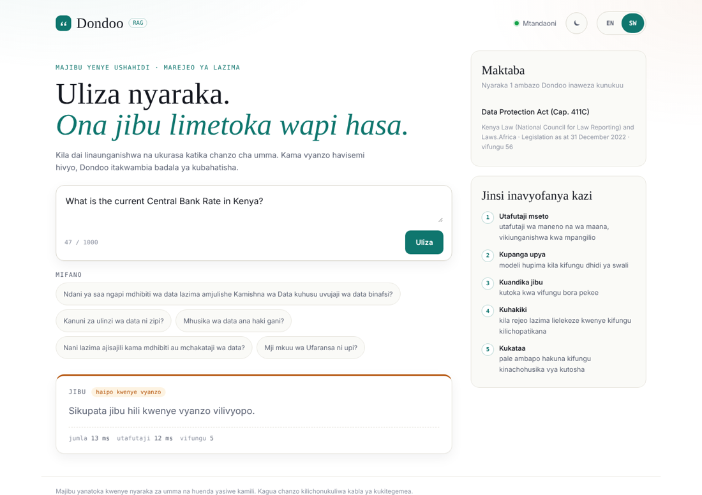
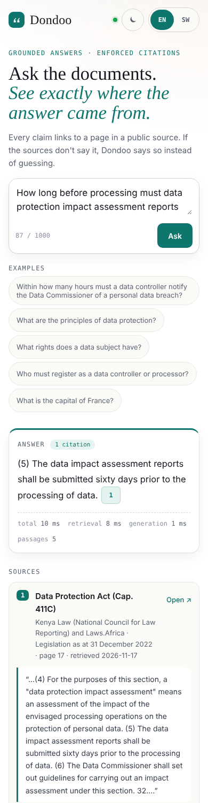
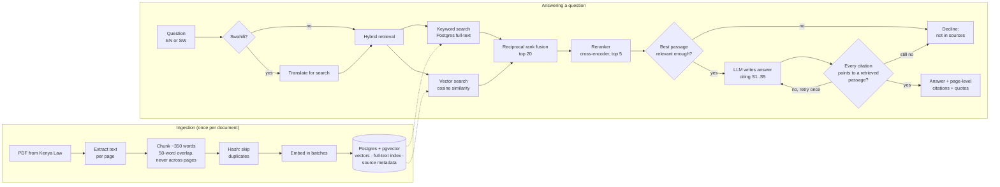

# Dondoo · production-style RAG with enforced citations

**Dondoo** (Swahili: *an excerpt, a quotation*) answers questions about Kenya's **Data Protection Act** and
cites the exact page behind every claim. If the documents do not contain the answer, it says so instead
of guessing. The interface works in **English and Kiswahili**, in light and dark mode, on any device.

It is built the way a company would need it: hybrid retrieval, a reranker, citation enforcement in code,
refusal of unsupported questions, a hand-verified golden test set, RAGAS evaluation, and a CI quality
gate that fails the build when answer quality drops.

> Status: the code, tests, database schema and offline evaluation are complete. The live evaluation
> (real models + RAGAS) runs in GitHub Actions once the `GEMINI_API_KEY` secret is added. Its numbers
> are published below only after a real run. None are filled in by hand.

## Screenshots

Running on the real Act (offline stand-in models, so answers here are extracted verbatim; with the live model they
are written as short answers with the same citations).

| Cited answer (light) | Cited answer (dark) |
| --- | --- |
|  |  |

| Declines in Kiswahili when the Act is silent | Phone |
| --- | --- |
|  |  |

---

## Architecture



| Layer | Choice | Why |
| --- | --- | --- |
| API | FastAPI (Python) | Typed request validation, async-ready, built-in OpenAPI docs at `/api/docs` |
| Store | PostgreSQL + **pgvector** on Supabase | One database for vectors, full-text search, metadata and access control |
| Keyword search | Postgres `tsvector` + GIN index (BM25 in the in-memory store) | Exact terms such as section numbers and defined words |
| Vector search | pgvector HNSW, cosine distance | Matches meaning when the wording differs |
| Fusion | Reciprocal rank fusion (k = 60) | Merges two rankings without tuning score scales |
| Reranker | Jina `jina-reranker-v2-base-multilingual` (hosted), baseline fallback | Reads question and passage together, so it ranks better than either search alone |
| Answer model | `openai/gpt-oss-120b` on Groq (fallback `gpt-oss-20b`; Gemini also supported) | Groq's free plan allows 1,000 requests/day per model against about 20 for Gemini Flash; OpenAI-compatible, so any provider or a self-hosted model (Ollama, vLLM) is one URL away |
| Embeddings and RAGAS judge | Gemini (`gemini-embedding-2`, Flash-Lite judge) | Free; a separate quota from the answer model, so evaluation does not starve answers |
| Evaluation | Golden set, RAGAS, own metrics, CI gate | Quality is measured on every change, not assumed |

All three model parts sit behind small interfaces (`Embedder`, `LLM`, `Reranker`). Any
OpenAI-compatible server works, including a self-hosted open model.

## How grounding is enforced

1. **Retrieval first.** The model only ever sees the top five reranked passages, each wrapped as
   `<source id="S1">…</source>` and marked as untrusted data.
2. **Relevance threshold.** If the best passage scores below `RAG_MIN_RELEVANCE`, the system declines
   without calling the LLM at all.
3. **Citation check in code.** The answer must cite `[S1]`-style markers, and every marker must point to
   a passage that was actually retrieved. Invented or missing citations trigger one retry, then a decline.
   An unchecked answer is never returned.
4. **"Not found" is a valid answer.** The model is told to reply `NOT_FOUND` when the sources do not
   contain the answer, and that becomes a clean decline in the UI.
5. **Prompt-injection defence.** Source text is escaped, labelled as data, and passages that look like
   instructions raise a visible warning.

## Evaluation

### Golden set: `eval/golden.jsonl`

**58 questions: 48 answerable and 10 that the Act does not answer** (off-topic, other laws, live data,
and a prompt-injection attempt).

Each answerable question has a reference answer and a **verbatim quote** from the Act. All 48 quotes were
checked word for word against the live Kenya Law text of the Act on 17 November 2026. Every quote was
found, and each appears **exactly once**, so a citation can be scored without ambiguity.
`scripts/verify_golden.py` repeats this check in CI against the downloaded PDF. It also reports any quote
that crosses a chunk or page boundary, since that would cap the retrieval score.

### Metrics

| Metric | Measured by | Question it answers |
| --- | --- | --- |
| Context precision | RAGAS | Are the retrieved passages relevant? |
| Context recall | RAGAS | Did retrieval find what the reference answer needs? |
| Faithfulness | RAGAS | Is every claim in the answer supported by the retrieved passages? |
| Citation accuracy | own, exact | Does a cited passage contain the verified quote? |
| Hit rate@5, MRR@5 | own, exact | Is the right passage retrieved, and how high? |
| Answer rate | own | Share of answerable questions answered rather than declined |
| Decline accuracy | own | Share of unanswerable questions correctly declined |
| Latency p50 / p95 | own | End-to-end time per question |

RAGAS needs a judge model, so those three scores are estimates. The citation, retrieval and decline
metrics are exact string checks against the verified quotes, with no judge involved.

### Quality gate

`eval/thresholds.json` sets a minimum for each metric (maximum for latency). `scripts/run_eval.py` exits
with an error when any is missed, which fails the GitHub Actions build.

| Workflow | When | What it proves |
| --- | --- | --- |
| `ci.yml` → tests | every push | 70+ unit, API, security and evaluation tests |
| `ci.yml` → offline-eval | every push | Golden quotes exist in the real PDF; the pipeline holds up with stand-in models |
| `eval.yml` | by hand (saves free-tier quota) | Real models + RAGAS on the golden set; the live gate |
| `index.yml` | by hand | Loads the corpus into Supabase for the deployed app |

The live thresholds are starting points. After the first real run, they are set just below the measured
baseline, so a regression fails the build. Each change is recorded here.

### Results

The latest reports are in each workflow run's summary and in the `offline-eval` and `live-eval` artifacts:
the metrics table, successful examples, and every failed question with the reason it failed.

**Offline baseline, 17 November 2026** (real Act, 58 questions, *stand-in* models: hashing embeddings,
word-overlap reranker and an extractive answerer, so no AI is involved and these are not model-quality numbers):

| hit rate@5 | MRR@5 | answer rate | citation accuracy | decline accuracy |
| --- | --- | --- | --- | --- |
| 0.896 | 0.842 | 0.938 | 0.844 | 0.800 |

The offline gate sits just below these, so any change that makes retrieval or citation checks worse fails CI.

**First live attempt, 17 November 2026:** with Gemini embeddings, retrieval found the right passage in the top 5
for 43 of 48 answerable questions, most at rank 1. The answering model then returned HTTP 429 "quota exceeded"
on the free tier, so no answer-quality or RAGAS scores exist yet. The pipeline now checks the model before a run
and does not retry quota errors. It now also paces calls for free per-minute limits (one every 13 s by default),
waits once when the provider says "retry in N s", and switches to `gemini-flash-lite-latest` when the main
model's daily quota runs out (`RAG_LLM_FALLBACK_MODELS`). The RAGAS judge uses Flash-Lite by default.
Because Gemini's free answer quota is so small, answers now go to Groq when a `GROQ_API_KEY` secret is set; its
"Please try again in 7.66s" per-minute limits are waited out (up to three times per call), and its daily limit
moves to the fallback model.
*Live answer and RAGAS results: pending a run with available quota.*

## Security

- **No secrets in code.** Everything comes from environment variables; `.env` is git-ignored.
- **Least privilege in the database.** Row level security is enabled with no policies on both tables,
  so Supabase's public REST API cannot read or write them. Only the server, using the database role,
  can. Supabase's advisor reports this as "RLS enabled, no policy", which is the intended setting.
- **Access levels** (public 0, staff 1, admin 2) are enforced inside the SQL query, before any text can
  reach the model.
- **Uploads:** admin token only (HS256 JWT with expiry; `alg: none` and forged tokens rejected),
  constant-time admin-key check, type allow-list, PDF signature check, size limit, path-traversal-safe
  file names, and `http(s)` URLs only.
- **Abuse:** per-client rate limit. `X-Forwarded-For` is trusted only for a configured number of proxy
  hops, so clients cannot forge their way past the limit.
- **Browser:** strict Content-Security-Policy (no inline scripts), `X-Frame-Options: DENY`, `nosniff`,
  `no-referrer`. All server text is rendered with `textContent`, never `innerHTML`.
- **Errors** never echo API keys, and internal errors return a request ID instead of a stack trace.

## Run it

```bash
pip install -e ".[dev,ragas,postgres]"
pytest -q                                    # all tests, no keys needed

python scripts/fetch_corpus.py               # download the Act (data/raw/)
python scripts/verify_golden.py              # check the golden quotes against it
python scripts/run_eval.py --mode offline    # evaluation with stand-in models

cp .env.example .env                         # add your keys, then:
python scripts/run_eval.py --mode live --ragas
uvicorn rag.main:app --reload                # http://127.0.0.1:8000
```

### Deploy (free tiers)

0. **PDF text quirk handled:** the PDF stores "fi" and "fl" as single ligature characters (218 words, such as
   "Notification"). Text is NFKC-normalised at ingestion and for every question, so keyword search matches.
1. **Supabase:** the schema is in `supabase/migrations/`. Use the **Session pooler** connection string
   (Project → Connect). The direct `db.<ref>.supabase.co` address is IPv6-only, and GitHub runners and
   Render are IPv4.
2. **GitHub secrets:** `GEMINI_API_KEY`, `GROQ_API_KEY`, `DATABASE_URL`, and optionally `JINA_API_KEY`. Then run
   *Actions → Load the corpus into Supabase*.
3. **Render:** *New → Blueprint* with this repo (`render.yaml`), then enter the same secrets. Free
   instances sleep when idle, so the first request after a pause takes longer.

## Corpus and licences

| Document | Source | Licence |
| --- | --- | --- |
| Data Protection Act (Cap. 411C), legislation as at 31 December 2022 | [Kenya Law](https://new.kenyalaw.org/akn/ke/act/2019/24/eng@2022-12-31) | CC BY-NC-SA 4.0 (Kenya Law and Laws.Africa); no copyright on the legislative content |

Kenya Law serves the PDF behind a browser check that blocks automated downloads, so an unmodified copy saved
from a browser is committed in `data/corpus/` with attribution (the licence allows non-commercial
redistribution). `data/corpus.lock.json` records each
file's SHA-256, so a silent change to a source fails the build until the golden set is re-checked. More
documents are added through `data/sources.json`.

Dondoo is a portfolio project and **not legal advice**. Always read the cited section of the Act.

## Project layout

```
src/rag/
  ingest/        extraction, chunking, ingestion pipeline
  store/         in-memory (BM25 + cosine) and Postgres/pgvector stores
  providers/     OpenAI-compatible LLM and embeddings, hosted reranker, offline stand-ins
  retrieval.py   hybrid search + reciprocal rank fusion + reranking
  answer.py      prompt, citation enforcement, declining, Swahili support
  evaluation/    golden set, metrics, RAGAS runner
  api.py         FastAPI app, auth, rate limiting, security headers
  web/           the Dondoo interface (HTML, CSS, JS; no build step)
scripts/         fetch_corpus, verify_golden, build_index, run_eval
eval/            golden.jsonl, thresholds.json
tests/           70+ tests
```

Code licence: MIT.
